# CatatCash (Self-Hosted) — v1

Aplikasi web pencatat keuangan pribadi, single-user, self-hosted. Berjalan penuh
secara lokal (MySQL/MariaDB) tanpa layanan pihak ketiga.

## Tampilan Aplikasi

Data pada tangkapan layar di bawah ini adalah data contoh.

### Desktop

#### PIN

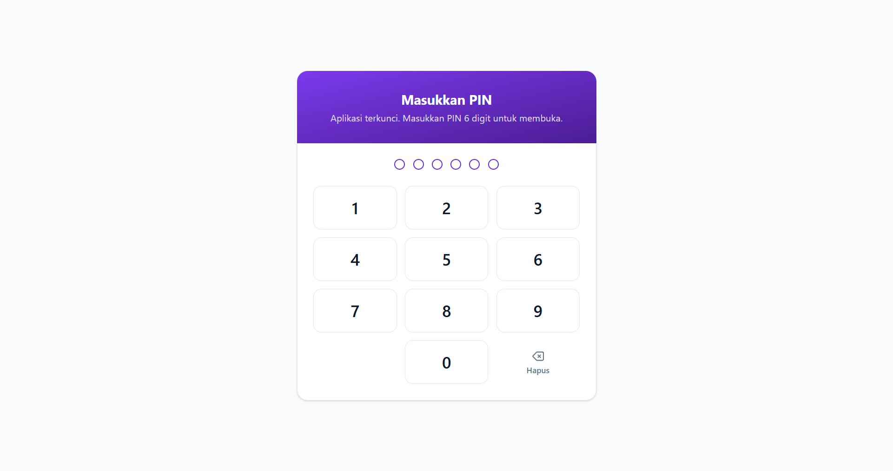

#### Beranda

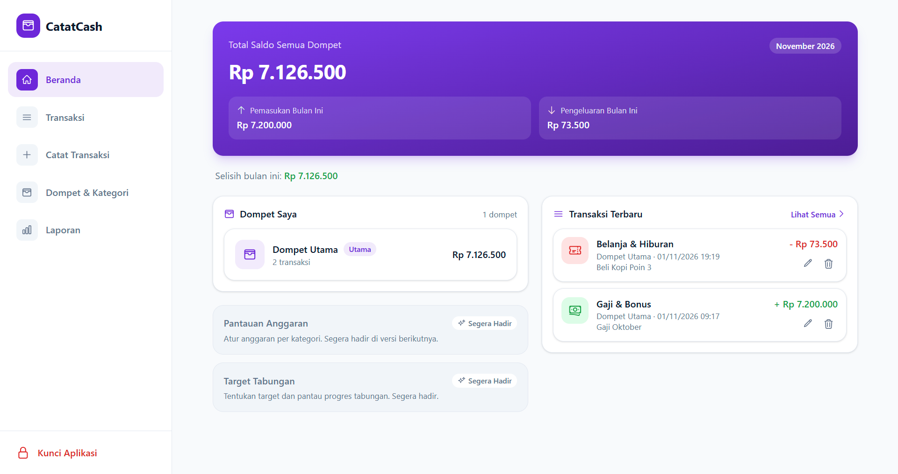

#### Transaksi

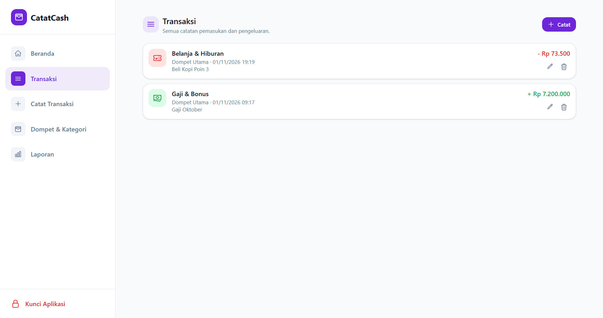

#### Catat Transaksi

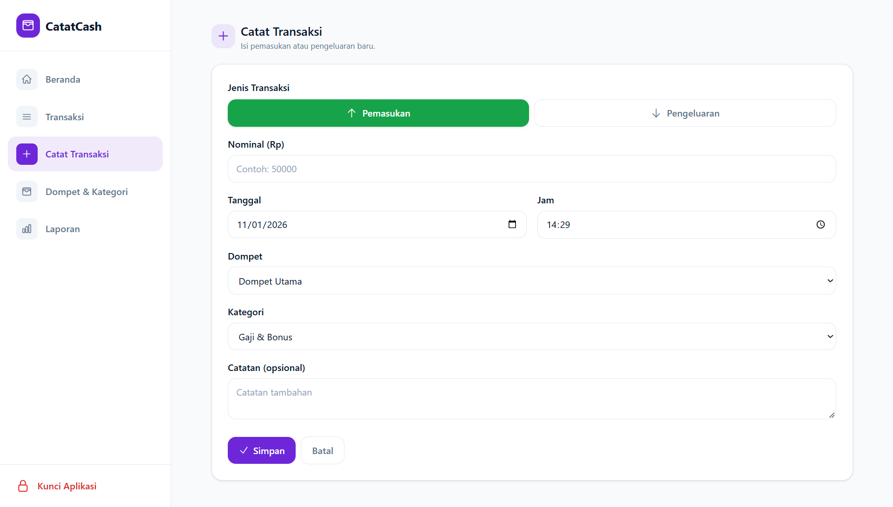

#### Dompet

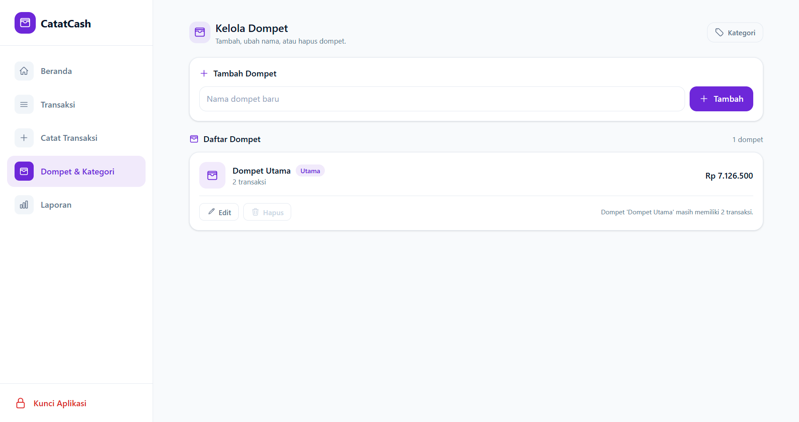

#### Laporan

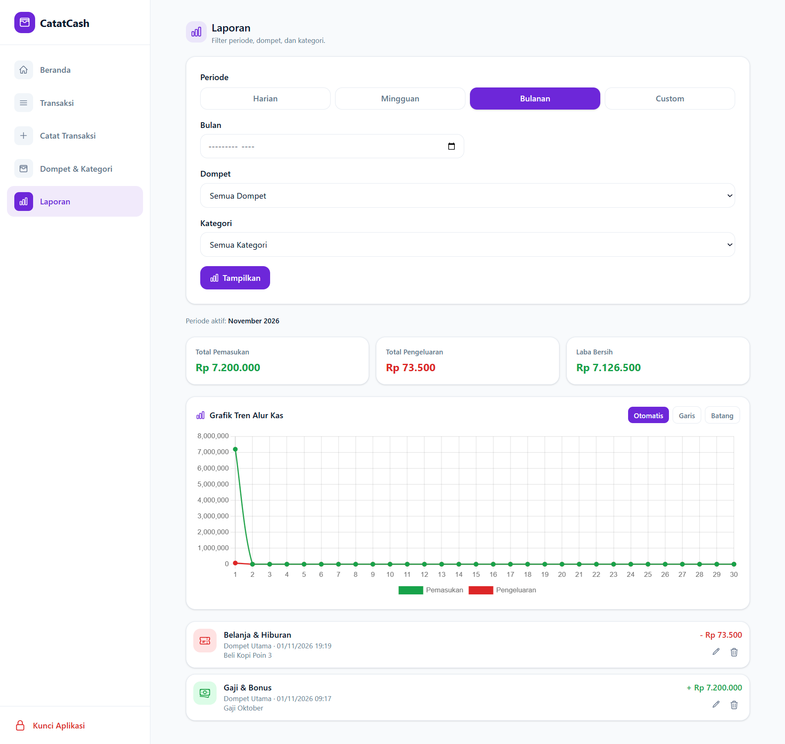

### Mobile

| PIN | Beranda | Transaksi |
| --- | --- | --- |
| 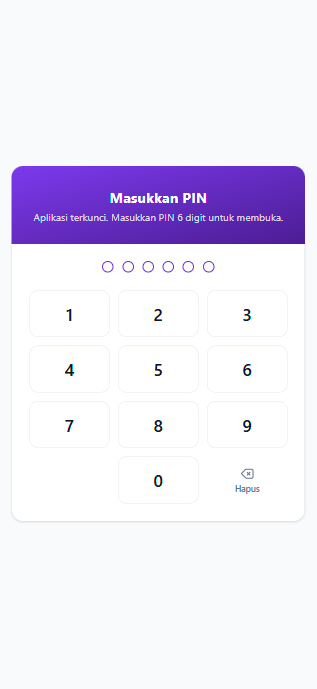 | 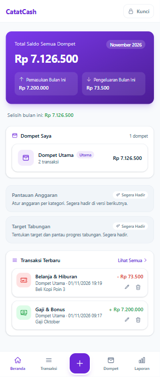 | 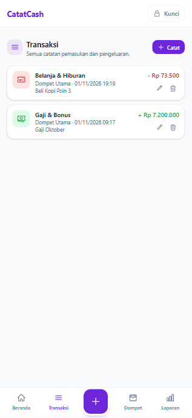 |

| Catat Transaksi | Dompet | Laporan |
| --- | --- | --- |
| 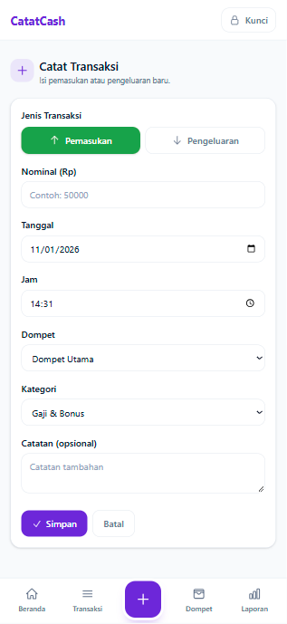 | 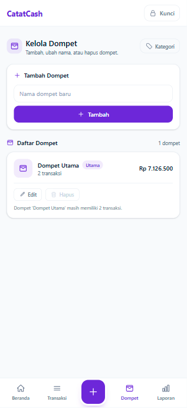 | 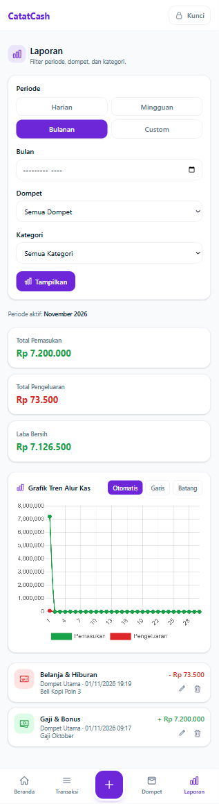 |

## Status v1

Seluruh tugas v1 (Tugas 1–11 di `TASKS.md`) selesai dan diuji:

- Kunci PIN: buat 6 digit, buka, kunci manual, lockout 5× salah / 5 menit, idle 15 menit, reset PIN.
- Beranda: total saldo, saldo per dompet, ringkasan bulan berjalan, transaksi terbaru (5 baris), kotak "Segera Hadir".
- Kelola Dompet & Kelola Kategori (tambah, ubah nama, hapus dengan aturan).
- Transaksi manual (tambah, ubah, hapus, daftar lengkap) dengan validasi server.
- Laporan (filter periode/dompet/kategori, total, Laba Bersih) + Grafik Tren Alur Kas.
- Saldo selalu dihitung dari transaksi (tidak ada kolom saldo statis).

Fitur v2 (suara, lampiran/scan nota, transfer, transaksi rutin, anggaran, target tabungan,
export/bagikan laporan, bot Telegram, Reality Check, versi Android) *belum* dibuat.

## Teknologi

- PHP 8.4 (Laravel 13 membutuhkan PHP 8.3+).
- Laravel 13.
- Database MySQL/MariaDB (bawaan Laragon), nama database: `catatcash`.
- Frontend: Vite, Tailwind CSS v4, Alpine.js 3, Chart.js 4 — semuanya dibundel lokal, tanpa CDN.

## Menjalankan di Laragon

1. Pastikan Laragon berjalan: PHP 8.3+ dan MySQL/MariaDB aktif.
2. Salin `.env.example` menjadi `.env`, lalu sesuaikan `DB_DATABASE=catatcash`,
   `DB_USERNAME`, dan `DB_PASSWORD` dengan pengaturan MySQL di komputer Anda.
   (File `.env` tidak pernah di-commit dan jangan dibagikan isinya.)
3. Pasang dependensi PHP dan buat kunci aplikasi:
   ```
   composer install
   php artisan key:generate
   ```
4. Siapkan database (migrasi + data awal: 1 dompet "Dompet Utama", 11 kategori):
   ```
   php artisan migrate --seed
   ```
5. Bangun aset frontend:
   ```
   npm install
   npm run build
   ```
6. Jalankan server lokal:
   ```
   php artisan serve
   ```
   Buka http://127.0.0.1:8000 — pertama kali aplikasi meminta membuat PIN 6 digit.

## Perintah penting

- Cek versi PHP: `php -v` (harus 8.3 atau lebih tinggi).
- Migrasi + seeder: `php artisan migrate --seed`.
- Build aset (tanpa CDN): `npm run build` (atau `npm run dev` saat pengembangan).
- Jalankan server: `php artisan serve`.
- Tes otomatis: `php artisan test`.
- Lupa/reset PIN (dijalankan pemilik server dari terminal):
  ```
  php artisan catatcash:reset-pin
  ```
  Menghapus PIN, mengosongkan hitungan salah & lockout, dan membersihkan semua sesi aktif.
  Tambahkan `--force` untuk melewati konfirmasi (mis. dipakai skrip).

## Struktur singkat

- `app/Http/Controllers` — PIN, Beranda, Dompet, Kategori, Transaksi, Laporan.
- `app/Services` — `PinSecurityService`, `BalanceCalculatorService`, `ReportAggregatorService`.
- `app/Support/CategoryIconResolver` — pemetaan ikon kategori (jenis + nama).
- `database/migrations`, `database/seeders` — skema & data awal.
- `resources/views` — layout + komponen Blade (DESIGN Bab 7–8).
- `resources/js` — Alpine (`app.js`) dan grafik (`cashflow-chart.js`).
- `tests/Feature` — tes otomatis v1.

## Catatan

- Aplikasi single-user; tidak ada pendaftaran akun dan tidak ada multi-user.
- Rahasia (`.env`, kunci aplikasi) tidak disimpan di repositori.